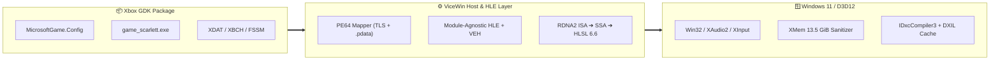

🌴 ViceWin

Xbox Series X|S (Scarlett) HLE Compatibility Layer & RDNA2 ➔ DXIL Shader Recompiler for Windows
• Platform: Windows 11 x64
• Target Hardware: AMD RDNA 3.5 (with general D3D12 SM 6.6 fallback)
• Language: C++20 / CMake
Note: Built and tuned directly on my AMD RDNA 3.5 setup. Works on other DirectX 12 (Shader Model 6.6) GPUs, though performance and behavior may vary.

Why I Built This

I started ViceWin with a single goal: get next-gen Xbox Series X (Scarlett / Gen9 Game Core) builds running natively on Windows 11 without heavy full-system hardware emulation.
Instead of emulating the whole console from scratch, ViceWin acts as a lightweight, native Win32 translation layer (similar in spirit to Wine/Proton) paired with a live RDNA2 ➔ DXIL (SM 6.6) shader recompiler. It maps the console PE64 executable directly into host memory, catches Xbox-specific OS, memory, audio, and d3d12_xs calls on the fly, and translates them straight into desktop Windows 11 / DirectX 12 calls.

Bring-Up & Telemetry Status

## How It Works

Building & Running

Requirements

• OS: Windows 11 x64
• Compiler & Build: MSVC 2022 (C++20) + CMake 3.20+
• Graphics: DirectX 12 GPU with Shader Model 6.6 support + Windows SDK (dxcompiler.dll / dxil.dll)

Compile & Run Tests

powershell
cmake -S . -B build
cmake --build build --config Release
ctest --test-dir build --output-on-failure
Будьте обачні, використовуючи код.

Launch a Package

1. Open build\Release\vicewin.exe (or run scarlettx_host.exe --in-process <path-to-exe>).
2. Point it to your extracted package folder containing MicrosoftGame.Config and the .exe.
3. Runtime logs and crash/IAT traces are written automatically to vicewin.log.

Credits & Acknowledgements

• The initial HLE runtime scaffolding, PE64 loader foundation, and Win32 GDK shim architecture were adapted from Freminet/ScarlettX — huge thanks to Freminet for the clean-room Xbox Series X|S base that made this project possible.

Legal

ViceWin is an independent, non-commercial research project exploring GPU architectures and binary/shader translation. This repository contains zero copyrighted game files, decryption keys, or proprietary Microsoft/Xbox SDK binaries.
