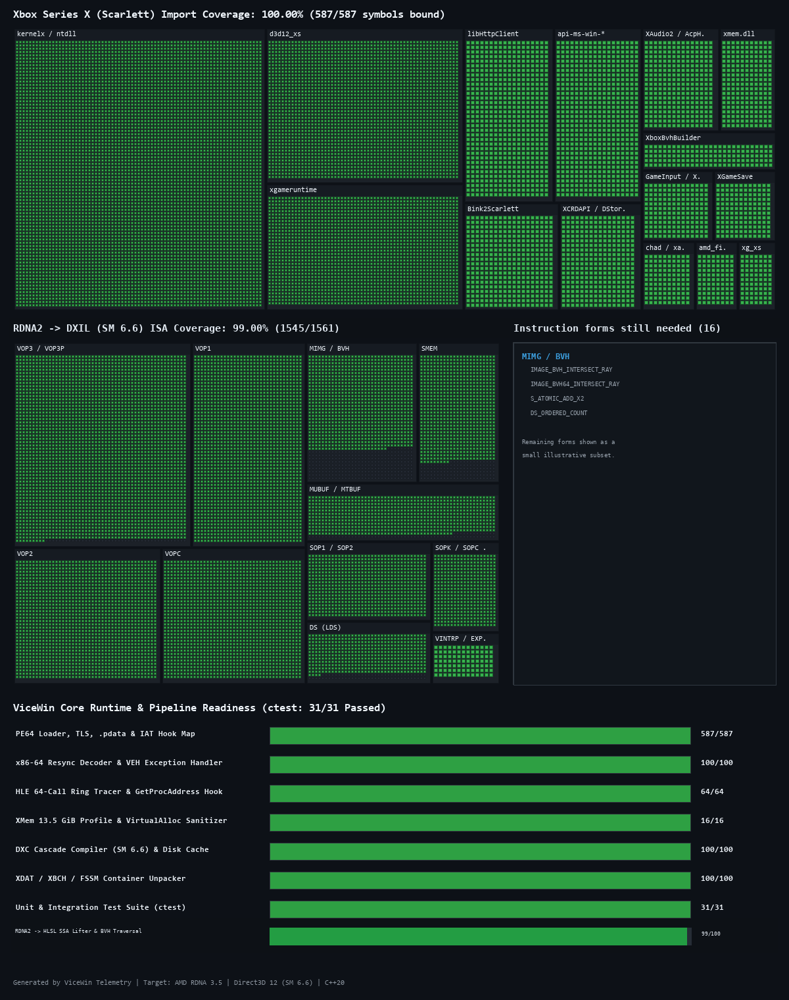
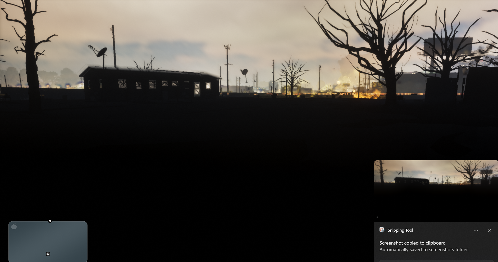
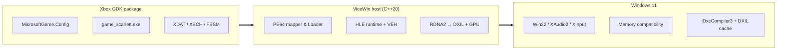

<div align="center">
<h1> ViceWin🌴 </h1>
</div>
<div align="center">

**Xbox Series X|S HLE compatibility layer and RDNA2 to DXIL shader recompiler for Windows**


JOIN OUR TEAM'S DISCORD CHANNEL https://discord.gg/VDYNTQKC8


</div>

ViceWin is a native Windows compatibility layer for Xbox Series X|S builds written in pure C++20. It focuses on
translation and high-level emulation instead of full-system hardware emulation.

The runtime maps Scarlett PE64 executables into host memory, intercepts Xbox-specific calls,
and translates console APIs, audio, and shaders into native Win32, DirectX 12, and Shader Model 6.6
interfaces.

> [!NOTE]
> ViceWin is developed and tuned primarily on AMD RDNA 3.5 hardware. Other DirectX 12
> Shader Model 6.6 GPUs may work, but performance and behavior can vary.

---

## Bring-up and telemetry

<div align="center">



<div align="center">
  
  
</div>
</div>

---

## Highlights

- **Native PE64 loading (`vicewin_pe`, `vicewin_loader`)** — maps Scarlett executables with TLS, `.pdata`, and `MicrosoftGame.Config` parsing
- **High-level emulation (`vicewin_hle`, `vicewin_core`)** — Win32/NT kernel shims, VEH/SEH tracing, memory management, XInput, and XAudio2
- **Full RDNA2 → DXIL shader recompiler (`vicewin_shader`, `vicewin_pipeline`)** — RDNA2 ISA lifting to SSA and HLSL/DXIL Shader Model 6.6 with BVH/DXR support
- **Console media & formats (`vicewin_formats`, `vicewin_game`)** — XMA2 audio decoding, BCn texture handling, SGD5 asset loaders, and CityHash
- **D3D12 GPU translation (`vicewin_gpu`)** — command list translation, synchronization, and persistent disk DXIL caching via `IDxcCompiler3`
- **Native GUI Launcher (`vicewin_launcher.exe`)** — Win32 + DirectX 11 + ImGui launcher with FPS limiter, V-Sync, GPU picker, live logs, and on-demand upscaler/SDK downloader (FSR / XeSS / DXC)

---

## How it works



---

## Requirements

| Component | Requirement |
| --- | --- |
| Operating system | Windows 11 x64 |
| Compiler | Microsoft Visual C++ 2022 |
| Language standard | C++20 |
| Build system | CMake 3.20 or newer |
| Graphics | DirectX 12 GPU with Shader Model 6.6 support |
| Windows SDK | `dxcompiler.dll` and `dxil.dll` (or downloaded via `vicewin_launcher.exe`) |

---

## What we have now

| Component | Now |
| --- | --- |
| Grand Theft Auto VI | Boots past loading into intro cutscenes & Lucia prologue (active work on RDNA2 opcodes, texture deswizzling & async PSO compilation) |
| Toolchain & Tests | Full C++20 codebase (`vicewin_core`, `vicewin_pe`, `vicewin_formats`, `vicewin_shader`, `vicewin_gpu`, `vicewin_hle`) + automated CTest suite |

---

## Build

```powershell
cmake -S . -B build
cmake --build build --config Release
```

## Run tests

```powershell
ctest --test-dir build --output-on-failure
```

---

## Launch a package

1. **Via GUI Launcher:** Open `build\Release\vicewin_launcher.exe`, select your extracted package folder (containing `MicrosoftGame.Config`) or `.exe`, configure FPS/V-Sync/upscalers, and click **Launch**.
2. **Via CLI:**

   ```powershell
   .\build\Release\vicewin.exe --in-process <path-to-exe>
   ```

3. Find runtime logs and crash/IAT traces in `vicewin.log`.

> [!WARNING]
> Use only game files, packages, binaries, and decryption material that you are legally
> authorized to access and run.

---

## Credits

The initial HLE runtime scaffolding, PE64 loader foundation, and Win32 GDK shim architecture
were adapted from [Freminet/ScarlettX](https://github.com/Freminet/ScarlettX). Many thanks to
Freminet for providing a clean-room Xbox Series X|S foundation.

---

## Legal

ViceWin is an independent, non-commercial research project focused on GPU architecture and
binary/shader translation.

This repository does not contain copyrighted game files, decryption keys, or proprietary
Microsoft/Xbox SDK binaries.
